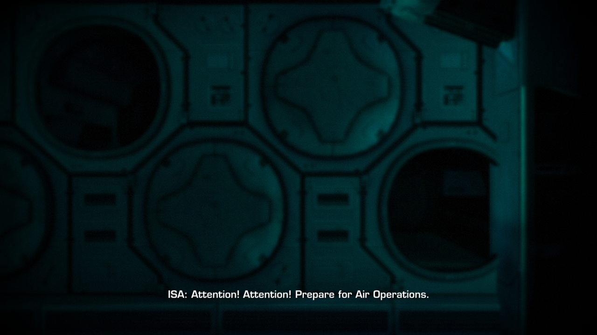
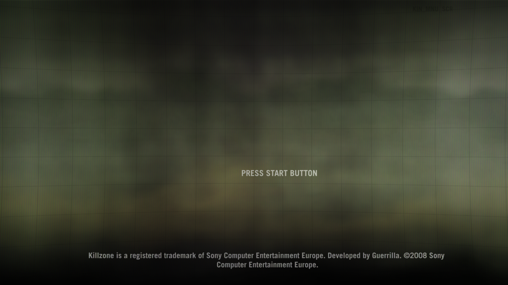
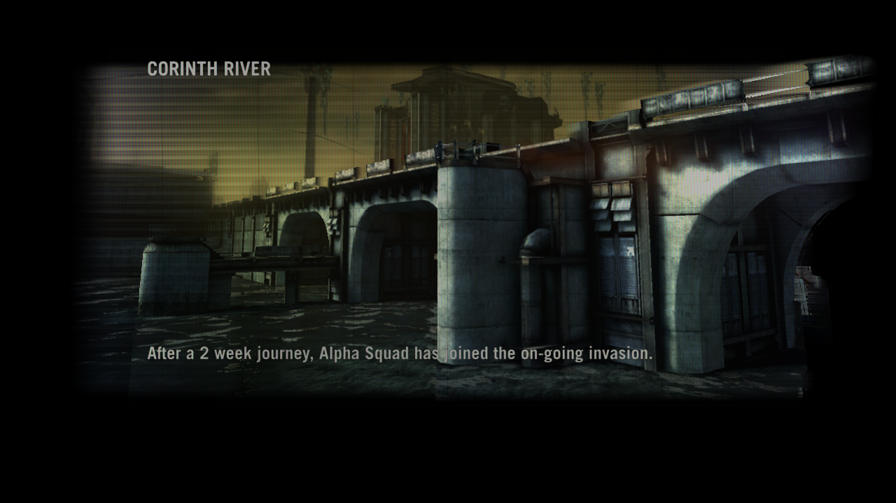

# Tokisaki Port (Killzone 2 PC Port)

[]()
[](https://en.cppreference.com/w/cpp/20)
[-lightgrey.svg)]()

> [!WARNING]
> **Work in progress — this is not a playable port.**
> The game boots, streams its data, runs its SPU jobs and walks its menus up to the start of a campaign, but it is far from playable: the campaign level loads and its loading screen renders, but the first in-level frames stall on a command-buffer park nothing patches (docs/PROGRESS.md §20), so nothing past the loading screen is shown yet; the intro movie stalls. Status details below.
> **Devam eden bir çalışma — oynanabilir bir port değildir.** Oyun açılıyor, verisini okuyor, SPU işlerini çalıştırıyor ve menülerinde bir kampanya başlatmaya kadar ilerliyor; kampanya seviyesi yükleniyor ve yükleme ekranı çiziliyor, ancak seviye içindeki ilk kareler yamalanmayan bir komut tamponu park noktasında takılıyor (docs/PROGRESS.md §20); giriş videosu takılıyor.
>
> Built on [ps3recomp](https://github.com/sp00nznet/ps3recomp); the boot harness is adapted from [Kurtisone/twistedmetal](https://github.com/Kurtisone/twistedmetal). Developed with an AI coding agent. See [CREDITS.md](CREDITS.md).

[English](#english) | [Türkçe](#türkçe)

---

<a id="english"></a>
## English

Static recompilation project for **Killzone 2** (PlayStation 3) targeting native PC execution.

### 📊 Project Status: boots, streams data, renders its first frames (pre-alpha)

Built on **[ps3recomp](https://github.com/sp00nznet/ps3recomp)** (v0.15.0, pinned as a submodule, with this port's fixes in `patches/ps3recomp/`). Linux/Vulkan is the primary host.

| Stage | State |
|---|---|
| EBOOT → ELF, PPU lift | **done** — 34,145 OPD functions → 67,196 lifted, 41 chunks, ~6.1 M lines of C++, 234 switch tables |
| SPU lift | **done** — 23 embedded SPU ELFs, the WWS job-manager policy module, 36 WWS job modules |
| Build & link | **done** — ~118 MB native x86-64 binary (clang, ~3 min at -j8) |
| Boot | CRT, TLS, SPURS ×2, FIOS, cellGcm 720p, display buffers/tiles/zcull, cellFont, cellSaveData, cellAudio, trophies |
| Asset streaming | **works** — FIOS reads `data_ps3.psarc`; Edge Zlib requests are inflated on the host |
| Rendering | title screen and menus with full text on Vulkan, 60-150 presented frames/s; campaign loading screen renders |
| Front end | language select → gamma → main menu → save warning → start screen → campaign difficulty → campaign start (driven with `PAD_SCRIPT`) |
| Movies / gameplay | intro movie player deadlocks (skipped via `tools/make_vfs_nointro.sh`); campaign start sound teardown hang resolved; advances to level asset loading; gameplay not reached |







Full engineering log: [docs/PROGRESS.md](docs/PROGRESS.md).

#### Roadmap
- [x] **Phase 0: Runtime & Build System** (ps3recomp submodule, CMake, Linux/Vulkan runner)
- [x] **Phase 1: ELF extraction & analysis** (imports, SPU images, job modules)
- [x] **Phase 2: Static recompilation** (PPU + SPU lifted and linked)
- [ ] **Phase 3: HLE / OS layer** — in progress (lwcond ABI, Edge Zlib, cellFont fixed; SVO front end next)
- [ ] **Phase 4: RSX rendering** — first passes render; final composition missing
- [ ] **Phase 5: Audio, input, game loop**
- [ ] **Phase 6: Playability**

### Name
The repository is named after Kurumi Tokisaki (*Date A Live*), a character who commands time — a nod to bringing a 2009 game forward. The name is the only thing it borrows; the engineering is below.

#
### Play in a window / Pencerede oynatma

```
tools/play.sh
```

Enter = START, Space = Cross, Esc = Circle, arrow keys = D-pad, R/F = Square,
T/C = Triangle, Q/E = L1/R1, Tab = SELECT; an SDL game controller also works.
The game currently runs through the menus to campaign start and stops at the
first physics step of the level.

## Credits
Most of what runs is other people's work: the **[ps3recomp](https://github.com/sp00nznet/ps3recomp)** toolkit and runtime (Ned Heller / sp00nznet and contributors), and the Linux boot harness of **[Kurtisone/twistedmetal](https://github.com/Kurtisone/twistedmetal)**, both MIT. Bugs fixed in `patches/ps3recomp/` were first found by others; see **[CREDITS.md](CREDITS.md)** and **[THIRD_PARTY_NOTICES.md](THIRD_PARTY_NOTICES.md)**. This port is developed by YYOzcan with an AI coding agent (Claude); the reasoning behind every change is in [docs/PROGRESS.md](docs/PROGRESS.md).

### Project Layout
```
├── CMakeLists.txt          # links the lifted game against the ps3recomp runtime
├── external/ps3recomp/     # toolkit + runtime (git submodule, pinned)
├── patches/ps3recomp/      # this port's fixes to the toolkit (tools/apply_patches.sh)
├── src/
│   ├── boot_main.cpp       # Linux/Windows runner: guest VM, frame clock, backend pick
│   ├── kz2_hle.cpp         # Killzone 2 HLE overrides (Edge Zlib, cellFont, ...)
│   ├── kz2_spu_pm.c        # registers the lifted WWS job-manager policy module
│   └── kz2_ftrace.cpp      # function-entry histogram (diagnostic builds)
├── tools/                  # lift / build / run / diagnostics scripts
└── docs/                   # PROGRESS.md (engineering log), ARCHITECTURE.md
```
Game files, the lifted C++ (`recompiled/`, `spu_recompiled/`) and loader output (`out/`) are generated from **your own** disc and are never committed.

### Building (Linux)
Requirements: clang, CMake ≥ 3.20, Ninja, Python ≥ 3.10, SDL2, Vulkan headers, glslang, zlib; a decrypted `EBOOT.ELF` in `game_dump/PS3_GAME/USRDIR/`.
```bash
git clone --recursive https://github.com/YYOzcan/tokisaki-port   # or: git submodule update --init
tools/apply_patches.sh      # this port's ps3recomp fixes
tools/lift.sh               # PPU: EBOOT.ELF -> recompiled/   (~1 min)
tools/lift_spu.sh           # SPU: images, policy module, job modules -> spu_recompiled/
BUILD_JOBS=8 tools/build.sh # ~0.6 GB RAM per job
```

### Running
```bash
tools/run.sh                # Vulkan window; KZ2_RSX=null for headless
```
`run/vfs/PS3_GAME` links to the dump, `/dev_hdd0` maps to `run/hdd0`, firmware fonts come from RPCS3's `dev_flash` (`PS3_DEV_FLASH`).

Diagnostics: `tools/snapshot.sh` (all thread stacks under gdb), `tools/sample.sh` (main-thread sampler), `tools/import_audit.py` (imports without HLE), `tools/psarc_map.py` (which archive members were read), `KZ2_PEEK` / `KZ2_DUMPAT` (watch guest memory).

---

<a id="türkçe"></a>
## Türkçe

**Killzone 2** (PlayStation 3) için geliştirilen, yerel PC çalıştırmasını hedefleyen statik yeniden derleme (static recompilation) projesidir.

### 📊 Proje Durumu: açılıyor, veri akıtıyor, ilk karelerini çiziyor (ön-alfa)

**[ps3recomp](https://github.com/sp00nznet/ps3recomp)** (v0.14.0, alt modül olarak sabitlendi; bu porta ait düzeltmeler `patches/ps3recomp/` altında) üzerine kuruludur. Ana hedef Linux/Vulkan'dır.

| Aşama | Durum |
|---|---|
| EBOOT → ELF, PPU çevirimi | **tamam** — 34.145 OPD fonksiyonu → 67.196 çevrilmiş fonksiyon, 41 parça, ~6,1 M satır C++ |
| SPU çevirimi | **tamam** — 23 gömülü SPU ELF, WWS iş yöneticisi policy module'ü, 36 WWS iş modülü |
| Derleme | **tamam** — ~118 MB yerel x86-64 çalıştırılabilir dosya |
| Açılış | CRT, TLS, 2×SPURS, FIOS, cellGcm 720p, ekran tamponları, cellFont, cellSaveData, cellAudio, kupalar |
| Varlık akışı | **çalışıyor** — FIOS `data_ps3.psarc` okuyor; Edge Zlib istekleri host'ta açılıyor |
| Grafik | menüler yazılarıyla Vulkan'da ekrana geliyor, saniyede 30-60+ kare (bazı harfler eksik) |
| Menüler | dil seçimi → gama → ana menü → kayıt uyarısı → başlangıç ekranı → zorluk seçimi → kampanya başlangıcı (`PAD_SCRIPT` ile) |
| Video / oynanış | giriş videosu oynatıcısı kilitleniyor (`tools/make_vfs_nointro.sh` ile atlanıyor); kampanya başlangıcı ses motoru kilitlenmesi çözüldü, seviye varlık yüklemesine geçildi; oynanışa ulaşılmadı |

Ayrıntılı mühendislik günlüğü: [docs/PROGRESS.md](docs/PROGRESS.md).

#### Yol Haritası
- [x] **Aşama 0: Çalışma zamanı ve derleme sistemi**
- [x] **Aşama 1: ELF çıkarımı ve analiz**
- [x] **Aşama 2: Statik çevirim (PPU + SPU)**
- [ ] **Aşama 3: HLE / işletim sistemi katmanı** — sürüyor
- [ ] **Aşama 4: RSX grafik** — ilk geçişler çiziliyor, son kompozisyon eksik
- [ ] **Aşama 5: Ses, giriş, oyun döngüsü**
- [ ] **Aşama 6: Oynanabilirlik**

### İsim
Depo adını *Date A Live*'daki, zamanı yöneten karakter Kurumi Tokisaki'den alır — 2009'dan kalma bir oyunu bugüne taşımaya bir gönderme. Karakterden alınan tek şey isimdir.

### Katkılar ve Lisanslar
Çalışan kodun büyük kısmı başkalarının emeğidir: **[ps3recomp](https://github.com/sp00nznet/ps3recomp)** araç seti ve çalışma zamanı (Ned Heller / sp00nznet ve katkıda bulunanlar) ile **[Kurtisone/twistedmetal](https://github.com/Kurtisone/twistedmetal)** projesinin Linux açılış iskeleti; ikisi de MIT lisanslıdır. `patches/ps3recomp/` içindeki hataları ilk bulanlar başkalarıdır. Ayrıntılar: **[CREDITS.md](CREDITS.md)**, **[THIRD_PARTY_NOTICES.md](THIRD_PARTY_NOTICES.md)**. Bu port YYOzcan tarafından bir yapay zekâ kodlama ajanı (Claude) ile geliştiriliyor; her değişikliğin gerekçesi [docs/PROGRESS.md](docs/PROGRESS.md) içinde.

### Derleme (Linux)
Gerekenler: clang, CMake ≥ 3.20, Ninja, Python ≥ 3.10, SDL2, Vulkan başlıkları, glslang, zlib; `game_dump/PS3_GAME/USRDIR/` içinde şifresi çözülmüş `EBOOT.ELF`.
```bash
git clone --recursive https://github.com/YYOzcan/tokisaki-port   # veya: git submodule update --init
tools/apply_patches.sh      # bu portun ps3recomp düzeltmeleri
tools/lift.sh               # PPU çevirimi -> recompiled/
tools/lift_spu.sh           # SPU çevirimi -> spu_recompiled/
BUILD_JOBS=8 tools/build.sh
```

### Çalıştırma
```bash
tools/run.sh                # Vulkan penceresi; başsız için KZ2_RSX=null
```
Oyun dosyaları ve diskinizden üretilen C++ kodu depoya asla eklenmez.
