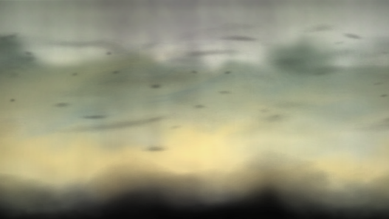

# Tokisaki Port (Killzone 2 PC Port)

[]()
[](https://en.cppreference.com/w/cpp/20)
[-lightgrey.svg)]()

[English](#english) | [Türkçe](#türkçe)

---

<a id="english"></a>
## English

Static recompilation project for **Killzone 2** (PlayStation 3) targeting native PC execution.

### 📊 Project Status: boots, streams data, renders its first frames (pre-alpha)

Built on **[ps3recomp](https://github.com/sp00nznet/ps3recomp)** (v0.14.0, pinned as a submodule, with this port's fixes in `patches/ps3recomp/`). Linux/Vulkan is the primary host.

| Stage | State |
|---|---|
| EBOOT → ELF, PPU lift | **done** — 34,145 OPD functions → 67,196 lifted, 41 chunks, ~6.1 M lines of C++, 234 switch tables |
| SPU lift | **done** — 23 embedded SPU ELFs, the WWS job-manager policy module, 36 WWS job modules |
| Build & link | **done** — ~118 MB native x86-64 binary (clang, ~3 min at -j8) |
| Boot | CRT, TLS, SPURS ×2, FIOS, cellGcm 720p, display buffers/tiles/zcull, cellFont, cellSaveData, cellAudio, trophies |
| Asset streaming | **works** — FIOS reads `data_ps3.psarc`; Edge Zlib requests are inflated on the host |
| Rendering | the front-end background renders into its offscreen target (see below); the presented frame is still black |
| Where it stops | after the `svo.svobootstrap` lump: the SVML front end (`interface/svo/svml/en/kin/index.jsp`) is never requested |
| Input / audio / gameplay | not reached |



Full engineering log: [docs/PROGRESS.md](docs/PROGRESS.md).

#### Roadmap
- [x] **Phase 0: Runtime & Build System** (ps3recomp submodule, CMake, Linux/Vulkan runner)
- [x] **Phase 1: ELF extraction & analysis** (imports, SPU images, job modules)
- [x] **Phase 2: Static recompilation** (PPU + SPU lifted and linked)
- [ ] **Phase 3: HLE / OS layer** — in progress (lwcond ABI, Edge Zlib, cellFont fixed; SVO front end next)
- [ ] **Phase 4: RSX rendering** — first passes render; final composition missing
- [ ] **Phase 5: Audio, input, game loop**
- [ ] **Phase 6: Playability**

### ⏳ Naming & Inspiration: Kurumi Tokisaki (時崎 狂三)

This project derives its name and philosophical inspiration from **Kurumi Tokisaki** (時崎 狂三), the iconic character from the *Date A Live* series.

- **Temporal Manipulation and Translation (Zafkiel)**:
  Kurumi commands **Zafkiel** (刻々帝), the Angel of Time, wielding mastery over past and future timelines. Tokisaki Port follows a parallel vision: liberating Killzone 2's binary from its 2009 entrapment within the complex **Cell Broadband Engine** architecture, bridging time via static recompilation to execute natively within modern C++20 standards on x86_64 host hardware.
- **Clones and Concurrency (City of Devouring Time)**:
  Kurumi's ability to summon and coordinate countless temporal clones perfectly mirrors the parallel dispatch of PlayStation 3's 6 user-accessible **SPU (Synergistic Processing Unit)** cores alongside the PPU onto modern high-core-count PC threads.
- **Ruthless Precision and Timing**:
  The asynchronous DMA queues, AltiVec/SPU vector instruction sets, and intricate memory barriers of the Cell architecture demand the exact same millisecond-grade precision as Kurumi's bullets traversing the clock dial.

### Project Layout
```
├── CMakeLists.txt          # links the lifted game against the ps3recomp runtime
├── external/ps3recomp/     # toolkit + runtime (git submodule, pinned)
├── patches/ps3recomp/      # this port's fixes to the toolkit (tools/apply_patches.sh)
├── src/
│   ├── boot_main.cpp       # Linux/Windows runner: guest VM, frame clock, backend pick
│   ├── kz2_hle.cpp         # Killzone 2 HLE overrides (Edge Zlib, cellFont, ...)
│   ├── kz2_spu_pm.c        # registers the lifted WWS job-manager policy module
│   └── kz2_ftrace.cpp      # function-entry histogram (diagnostic builds)
├── tools/                  # lift / build / run / diagnostics scripts
└── docs/                   # PROGRESS.md (engineering log), ARCHITECTURE.md
```
Game files, the lifted C++ (`recompiled/`, `spu_recompiled/`) and loader output (`out/`) are generated from **your own** disc and are never committed.

### Building (Linux)
Requirements: clang, CMake ≥ 3.20, Ninja, Python ≥ 3.10, SDL2, Vulkan headers, glslang, zlib; a decrypted `EBOOT.ELF` in `game_dump/PS3_GAME/USRDIR/`.
```bash
git submodule update --init
tools/apply_patches.sh      # this port's ps3recomp fixes
tools/lift.sh               # PPU: EBOOT.ELF -> recompiled/   (~1 min)
tools/lift_spu.sh           # SPU: images, policy module, job modules -> spu_recompiled/
BUILD_JOBS=8 tools/build.sh # ~0.6 GB RAM per job
```

### Running
```bash
tools/run.sh                # Vulkan window; KZ2_RSX=null for headless
```
`run/vfs/PS3_GAME` links to the dump, `/dev_hdd0` maps to `run/hdd0`, firmware fonts come from RPCS3's `dev_flash` (`PS3_DEV_FLASH`).

Diagnostics: `tools/snapshot.sh` (all thread stacks under gdb), `tools/sample.sh` (main-thread sampler), `tools/import_audit.py` (imports without HLE), `tools/psarc_map.py` (which archive members were read), `KZ2_PEEK` / `KZ2_DUMPAT` (watch guest memory).

---

<a id="türkçe"></a>
## Türkçe

**Killzone 2** (PlayStation 3) için geliştirilen, yerel PC çalıştırmasını hedefleyen statik yeniden derleme (static recompilation) projesidir.

### 📊 Proje Durumu: açılıyor, veri akıtıyor, ilk karelerini çiziyor (ön-alfa)

**[ps3recomp](https://github.com/sp00nznet/ps3recomp)** (v0.14.0, alt modül olarak sabitlendi; bu porta ait düzeltmeler `patches/ps3recomp/` altında) üzerine kuruludur. Ana hedef Linux/Vulkan'dır.

| Aşama | Durum |
|---|---|
| EBOOT → ELF, PPU çevirimi | **tamam** — 34.145 OPD fonksiyonu → 67.196 çevrilmiş fonksiyon, 41 parça, ~6,1 M satır C++ |
| SPU çevirimi | **tamam** — 23 gömülü SPU ELF, WWS iş yöneticisi policy module'ü, 36 WWS iş modülü |
| Derleme | **tamam** — ~118 MB yerel x86-64 çalıştırılabilir dosya |
| Açılış | CRT, TLS, 2×SPURS, FIOS, cellGcm 720p, ekran tamponları, cellFont, cellSaveData, cellAudio, kupalar |
| Varlık akışı | **çalışıyor** — FIOS `data_ps3.psarc` okuyor; Edge Zlib istekleri host'ta açılıyor |
| Grafik | menü arka planı offscreen hedefe çiziliyor; ekrana giden kare hâlâ siyah |
| Durduğu yer | `svo.svobootstrap` lump'ından sonra SVML arayüzü (`index.jsp`) hiç istenmiyor |
| Giriş / ses / oynanış | henüz ulaşılmadı |

Ayrıntılı mühendislik günlüğü: [docs/PROGRESS.md](docs/PROGRESS.md).

#### Yol Haritası
- [x] **Aşama 0: Çalışma zamanı ve derleme sistemi**
- [x] **Aşama 1: ELF çıkarımı ve analiz**
- [x] **Aşama 2: Statik çevirim (PPU + SPU)**
- [ ] **Aşama 3: HLE / işletim sistemi katmanı** — sürüyor
- [ ] **Aşama 4: RSX grafik** — ilk geçişler çiziliyor, son kompozisyon eksik
- [ ] **Aşama 5: Ses, giriş, oyun döngüsü**
- [ ] **Aşama 6: Oynanabilirlik**

### ⏳ İsimlendirme ve İlham: Kurumi Tokisaki (時崎 狂三)

Bu proje, adını ve felsefi ilhamını *Date A Live* serisinin unutulmaz karakteri **Kurumi Tokisaki**'den (時崎 狂三) almaktadır.

- **Zaman Manipülasyonu ve Zamansal Geçiş (Zafkiel)**:
  Kurumi Tokisaki, zamanı bükebilen, geçmişe ve geleceğe hükmedebilen melek **Zafkiel**'in (刻々帝) efendisidir. Bu port projesi de aynı vizyonla hareket eder: 2009 yılında PlayStation 3'ün karmaşık **Cell Broadband Engine** mimarisine hapsolmuş olan Killzone 2 ikili kodunu (binary), statik yeniden derleme vasıtasıyla zamanın ötesine taşıyarak modern C++20 standartlarında yerel (native) x86_64 mimarisine dönüştürür.
- **Klonlar ve Eşzamanlılık (City of Devouring Time)**:
  Kurumi'nin kendi zaman çizelgelerinden çağırdığı çok sayıda klonunun senkronize çalışması; PlayStation 3'ün 6 adet **SPU (Synergistic Processing Unit)** çekirdeğinin ve PPU yapısının modern çok çekirdekli PC işlemcilerinde yüksek paralellikte koşturulması mimarisiyle doğrudan örtüşür.
- **Kusursuz Hassasiyet ve Zamanlama**:
  Cell mimarisinin asenkron DMA kuyrukları, AltiVec/SPU vektör yönergeleri ve karmaşık bellek bariyerleri; Kurumi'nin saat kadranı üzerindeki mermileri gibi milisaniyelik bir zamanlama hassasiyeti gerektirir.

### Derleme (Linux)
Gerekenler: clang, CMake ≥ 3.20, Ninja, Python ≥ 3.10, SDL2, Vulkan başlıkları, glslang, zlib; `game_dump/PS3_GAME/USRDIR/` içinde şifresi çözülmüş `EBOOT.ELF`.
```bash
git submodule update --init
tools/apply_patches.sh      # bu portun ps3recomp düzeltmeleri
tools/lift.sh               # PPU çevirimi -> recompiled/
tools/lift_spu.sh           # SPU çevirimi -> spu_recompiled/
BUILD_JOBS=8 tools/build.sh
```

### Çalıştırma
```bash
tools/run.sh                # Vulkan penceresi; başsız için KZ2_RSX=null
```
Oyun dosyaları ve diskinizden üretilen C++ kodu depoya asla eklenmez.
