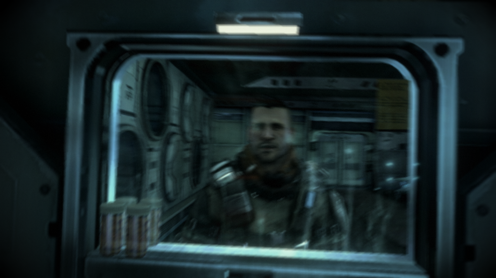
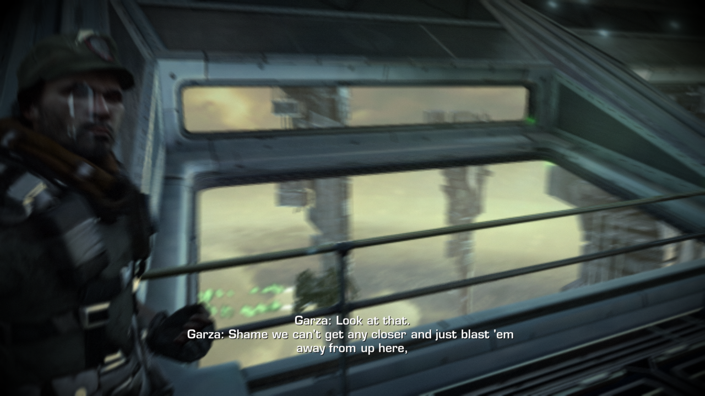

# Tokisaki Port (Killzone 2 PC Port)

[-orange.svg)]()
[](https://en.cppreference.com/w/cpp/20)
[-lightgrey.svg)]()

> [!WARNING]
> **Work in progress — playable only in a limited sense.**
> The campaign starts, the opening cutscene on *The New Sun* plays and you can play the first level with keyboard and mouse or a controller, with sound — at **~13-14 frames/s** (Radeon 680M, laptop in power-saver; the game advances at most 1/15 s per frame, so its clock runs at ~90% of real time and at full speed from 15 frames/s). The level start can still stop during the load now and then. On a desktop (Ryzen 5 5600, RTX 3060, `KZ2_MAX=1` build) the Corinth River battle after the prologue runs at **~14-15 frames/s**. Details below and in docs/PROGRESS.md §40-64.
> **Devam eden bir çalışma — ancak sınırlı anlamda oynanabilir.** Kampanya başlıyor, *The New Sun* açılış sinematiği oynuyor ve ilk bölüm klavye+fare ya da kontrolcüyle, sesli olarak oynanabiliyor: **~13-14 kare/s** (Radeon 680M, dizüstü güç tasarrufu modunda; oyun kare başına en fazla 1/15 s ilerlediği için saati gerçek zamanın ~%90'ı hızında akıyor, 15 kare/s'den itibaren tam hızda). Bölüm yüklenirken ara sıra hâlâ takılabiliyor. Masaüstünde (Ryzen 5 5600, RTX 3060, `KZ2_MAX=1` derlemesi) prolog sonrasındaki Corinth River çatışması **~14-15 kare/s**.
>
> Built on [ps3recomp](https://github.com/sp00nznet/ps3recomp); the boot harness is adapted from [Kurtisone/twistedmetal](https://github.com/Kurtisone/twistedmetal). Developed with an AI coding agent. See [CREDITS.md](CREDITS.md).

[English](#english) | [Türkçe](#türkçe)

---

<a id="english"></a>
## English

Static recompilation project for **Killzone 2** (PlayStation 3) targeting native PC execution.

### 📊 Project Status: boots, streams data, renders its first frames (pre-alpha)

Built on **[ps3recomp](https://github.com/sp00nznet/ps3recomp)** (v0.15.0, pinned as a submodule, with this port's fixes in `patches/ps3recomp/`). Linux/Vulkan is the primary host.

| Stage | State |
|---|---|
| EBOOT → ELF, PPU lift | **done** — 34,145 OPD functions → 67,196 lifted, 41 chunks, ~6.1 M lines of C++, 234 switch tables |
| SPU lift | **done** — 23 embedded SPU ELFs, the WWS job-manager policy module, 36 WWS job modules |
| Build & link | **done** — ~118 MB native x86-64 binary (clang, ~3 min at -j8) |
| Boot | CRT, TLS, SPURS ×2, FIOS, cellGcm 720p, display buffers/tiles/zcull, cellFont, cellSaveData, cellAudio, trophies |
| Asset streaming | **works** — FIOS reads `data_ps3.psarc`; Edge Zlib requests are inflated on the host |
| Rendering | Vulkan, batched submissions; menus at ~250 presented frames/s; the level renders its deferred passes, shadows and post-processing (teal cast: the colour-grading LUT is still an identity fill) |
| Front end | language select → gamma → main menu → save warning → start screen → campaign difficulty → campaign start |
| Movies / gameplay | intro movie player deadlocks (skipped via `tools/make_vfs_nointro.sh`); Corinth River loads in ~70 s, the opening cutscene on *The New Sun* plays and gameplay starts ("Follow Garza to the Launch Bay") at **~13-14 frames/s** on the Radeon 680M in power-saver (§54-57: SPU floats in MXCSR round-toward-zero mode, a vertex cache, batches in flight, Z16 targets on the GPU, jm_post on four SPUs) |
| Audio | menus and level |
| Input | keyboard + mouse (first-person layout) or an SDL game controller |
| Stability | the Havok-step stall at level start is fixed (§53); an occasional stop during the level load remains |






Full engineering log: [docs/PROGRESS.md](docs/PROGRESS.md).

#### Roadmap
- [x] **Phase 0: Runtime & Build System** (ps3recomp submodule, CMake, Linux/Vulkan runner)
- [x] **Phase 1: ELF extraction & analysis** (imports, SPU images, job modules)
- [x] **Phase 2: Static recompilation** (PPU + SPU lifted and linked)
- [ ] **Phase 3: HLE / OS layer** — in progress (lwcond ABI, Edge Zlib, cellFont fixed; SVO front end next)
- [ ] **Phase 4: RSX rendering** — first passes render; final composition missing
- [ ] **Phase 5: Audio, input, game loop**
- [ ] **Phase 6: Playability**

### Name
The repository is named after Kurumi Tokisaki (*Date A Live*), a character who commands time — a nod to bringing a 2009 game forward. The name is the only thing it borrows; the engineering is below.

#
### Play in a window / Pencerede oynatma

```
tools/play.sh
```

| Key / Tuş | Pad | | Key / Tuş | Pad |
|---|---|---|---|---|
| W A S D | left stick (move) | | Mouse / Fare | right stick (look) |
| Left click / Sol tık | R1 (fire) | | Right click / Sağ tık | L1 (aim) |
| Space | Cross (jump) | | C | Circle (crouch) |
| R / F | Square (reload) | | T / C | Triangle (weapon) |
| G | R2 (grenade) | | Z | L2 (cover) |
| Left Shift | L3 (sprint) | | V / middle click | R3 (melee) |
| Enter | START (pause) | | Esc / Backspace | Circle (back) |
| Arrow keys / Ok tuşları | D-pad | | Tab | SELECT |
| F1 | release / recapture the mouse | | Ctrl (hold) + mouse | SIXAXIS tilt (valves, charges) |

An SDL game controller also works. `tools/install_desktop_entry.sh` adds
*Killzone 2* to the application menu (it runs `tools/play.sh`; with Tk
installed, `KZ2_ENTRY=launcher` makes it open `tools/launcher.py`). On a hybrid laptop the integrated GPU is
used by default (`KZ2_GPU=dgpu tools/play.sh` for the discrete one);
`PS3_PAD_MOUSE_SENS` sets the look speed.

**Frame rate / Kare hızı.** The level runs at ~13-14 frames/s on a Ryzen 7
170 laptop in its *power-saver* profile; the CPU is the limit (the RSX
emulation thread and the SPU post-processing take turns), so a balanced or
performance power profile gives more. The game advances at most 1/15 s per
frame: from 15 frames/s its clock runs at real time. Optional for your own
build: profile-guided optimisation of the lifted SPU code (`cmake -B build
-DKZ2_SPU_PGO=gen`, build, run with `KZ2_PGO=5500,7000` past those frames,
`llvm-profdata merge -o pgo/spu.profdata build/pgo/*.profraw`, then
`-DKZ2_SPU_PGO=use` and build again) -- ~9% off the heaviest SPU job.
/ Bölüm, güç tasarrufu modundaki Ryzen 7 170 dizüstünde ~13-14 kare/s
çalışıyor; sınır işlemci, dengeli/performans güç profili daha fazlasını verir.
Oyun kare başına en fazla 1/15 s ilerler: 15 kare/s'den itibaren saati gerçek
zamanda akar.

## Credits
Most of what runs is other people's work: the **[ps3recomp](https://github.com/sp00nznet/ps3recomp)** toolkit and runtime (Ned Heller / sp00nznet and contributors), and the Linux boot harness of **[Kurtisone/twistedmetal](https://github.com/Kurtisone/twistedmetal)**, both MIT. Bugs fixed in `patches/ps3recomp/` were first found by others; see **[CREDITS.md](CREDITS.md)** and **[THIRD_PARTY_NOTICES.md](THIRD_PARTY_NOTICES.md)**. This port is developed by YYOzcan with an AI coding agent (Claude); the reasoning behind every change is in [docs/PROGRESS.md](docs/PROGRESS.md).

### Project Layout
```
├── CMakeLists.txt          # links the lifted game against the ps3recomp runtime
├── external/ps3recomp/     # toolkit + runtime (git submodule, pinned)
├── patches/ps3recomp/      # this port's fixes to the toolkit (tools/apply_patches.sh)
├── src/
│   ├── boot_main.cpp       # Linux/Windows runner: guest VM, frame clock, backend pick
│   ├── kz2_hle.cpp         # Killzone 2 HLE overrides (Edge Zlib, cellFont, ...)
│   ├── kz2_spu_pm.c        # registers the lifted WWS job-manager policy module
│   └── kz2_ftrace.cpp      # function-entry histogram (diagnostic builds)
├── tools/                  # lift / build / run / diagnostics scripts
└── docs/                   # PROGRESS.md (engineering log), ARCHITECTURE.md
```
Game files, the lifted C++ (`recompiled/`, `spu_recompiled/`) and loader output (`out/`) are generated from **your own** disc and are never committed.

### Building (Linux)
Requirements: clang, CMake ≥ 3.20, Ninja, Python ≥ 3.10, SDL2, Vulkan headers, glslang, zlib; a decrypted `EBOOT.ELF` in `game_dump/PS3_GAME/USRDIR/`.
```bash
git clone --recursive https://github.com/YYOzcan/tokisaki-port   # or: git submodule update --init
tools/apply_patches.sh      # this port's ps3recomp fixes
tools/lift.sh               # PPU: EBOOT.ELF -> recompiled/   (~1 min)
tools/lift_spu.sh           # SPU: images, policy module, job modules -> spu_recompiled/
BUILD_JOBS=8 tools/build.sh # ~0.6 GB RAM per job
```
For this machine only, at full strength (16 GB RAM or more): `KZ2_MAX=1 BUILD_JOBS=8 tools/build.sh`
-- `-march=native`, the lifted PPU code at `-O2`, the SPU code with `pgo/spu.profdata` when present
(~7 min on a Ryzen 5 5600; ~7% more frames per second than the default build, docs/PROGRESS.md §62).
Without system packages for Ninja or the Vulkan headers: `pip install ninja` into `.venv`, and
`CMAKE_ARGS=-DPS3RECOMP_VULKAN_INCLUDE_DIR=<Vulkan-Headers>/include` on the first build.
The firmware fonts can come from the disc's own update: `rpcs3 --installfw game_dump/PS3_UPDATE/PS3UPDAT.PUP`.

### Running
```bash
tools/run.sh                # Vulkan window; KZ2_RSX=null for headless
```
`run/vfs/PS3_GAME` links to the dump, `/dev_hdd0` maps to `run/hdd0`, firmware fonts come from RPCS3's `dev_flash` (`PS3_DEV_FLASH`).

Diagnostics: `tools/snapshot.sh` (all thread stacks under gdb), `tools/sample.sh` (main-thread sampler), `tools/import_audit.py` (imports without HLE), `tools/psarc_map.py` (which archive members were read), `KZ2_PEEK` / `KZ2_DUMPAT` (watch guest memory).

---

<a id="türkçe"></a>
## Türkçe

**Killzone 2** (PlayStation 3) için geliştirilen, yerel PC çalıştırmasını hedefleyen statik yeniden derleme (static recompilation) projesidir.

### 📊 Proje Durumu: açılıyor, veri akıtıyor, ilk karelerini çiziyor (ön-alfa)

**[ps3recomp](https://github.com/sp00nznet/ps3recomp)** (v0.15.0, alt modül olarak sabitlendi; bu porta ait düzeltmeler `patches/ps3recomp/` altında) üzerine kuruludur. Ana hedef Linux/Vulkan'dır.

| Aşama | Durum |
|---|---|
| EBOOT → ELF, PPU çevirimi | **tamam** — 34.145 OPD fonksiyonu → 67.196 çevrilmiş fonksiyon, 41 parça, ~6,1 M satır C++ |
| SPU çevirimi | **tamam** — 23 gömülü SPU ELF, WWS iş yöneticisi policy module'ü, 36 WWS iş modülü |
| Derleme | **tamam** — ~118 MB yerel x86-64 çalıştırılabilir dosya |
| Açılış | CRT, TLS, 2×SPURS, FIOS, cellGcm 720p, ekran tamponları, cellFont, cellSaveData, cellAudio, kupalar |
| Varlık akışı | **çalışıyor** — FIOS `data_ps3.psarc` okuyor; Edge Zlib istekleri host'ta açılıyor |
| Grafik | Vulkan, toplu gönderim; menüler ~250 kare/s; bölümde ertelenmiş aydınlatma, gölgeler ve son işlem çiziliyor (deniz mavisi ton: renk tablosu hâlâ birim dolgu) |
| Menüler | dil seçimi → gama → ana menü → kayıt uyarısı → başlangıç ekranı → zorluk seçimi → kampanya başlangıcı |
| Video / oynanış | giriş videosu oynatıcısı kilitleniyor (`tools/make_vfs_nointro.sh` ile atlanıyor); Corinth River ~70 s'de yükleniyor, *The New Sun* açılış sinematiği oynuyor ve oynanış başlıyor ("Follow Garza to the Launch Bay"): güç tasarrufu modundaki Radeon 680M'de **~13-14 kare/s** (§54-57: MXCSR sıfıra-yuvarlama modunda SPU float'ları, köşe önbelleği, uçuştaki partiler, GPU'da Z16, dört SPU'da jm_post) |
| Ses | menülerde ve bölümde |
| Kontrol | klavye + fare (FPS düzeni) veya SDL kontrolcü |
| Kararlılık | bölüm başındaki Havok fizik takılması düzeltildi (§53); yüklemede ara sıra bir durma kalıyor |

Ayrıntılı mühendislik günlüğü: [docs/PROGRESS.md](docs/PROGRESS.md).

#### Yol Haritası
- [x] **Aşama 0: Çalışma zamanı ve derleme sistemi**
- [x] **Aşama 1: ELF çıkarımı ve analiz**
- [x] **Aşama 2: Statik çevirim (PPU + SPU)**
- [ ] **Aşama 3: HLE / işletim sistemi katmanı** — sürüyor
- [ ] **Aşama 4: RSX grafik** — ilk geçişler çiziliyor, son kompozisyon eksik
- [ ] **Aşama 5: Ses, giriş, oyun döngüsü**
- [ ] **Aşama 6: Oynanabilirlik**

### İsim
Depo adını *Date A Live*'daki, zamanı yöneten karakter Kurumi Tokisaki'den alır — 2009'dan kalma bir oyunu bugüne taşımaya bir gönderme. Karakterden alınan tek şey isimdir.

### Katkılar ve Lisanslar
Çalışan kodun büyük kısmı başkalarının emeğidir: **[ps3recomp](https://github.com/sp00nznet/ps3recomp)** araç seti ve çalışma zamanı (Ned Heller / sp00nznet ve katkıda bulunanlar) ile **[Kurtisone/twistedmetal](https://github.com/Kurtisone/twistedmetal)** projesinin Linux açılış iskeleti; ikisi de MIT lisanslıdır. `patches/ps3recomp/` içindeki hataları ilk bulanlar başkalarıdır. Ayrıntılar: **[CREDITS.md](CREDITS.md)**, **[THIRD_PARTY_NOTICES.md](THIRD_PARTY_NOTICES.md)**. Bu port YYOzcan tarafından bir yapay zekâ kodlama ajanı (Claude) ile geliştiriliyor; her değişikliğin gerekçesi [docs/PROGRESS.md](docs/PROGRESS.md) içinde.

### Derleme (Linux)
Gerekenler: clang, CMake ≥ 3.20, Ninja, Python ≥ 3.10, SDL2, Vulkan başlıkları, glslang, zlib; `game_dump/PS3_GAME/USRDIR/` içinde şifresi çözülmüş `EBOOT.ELF`.
```bash
git clone --recursive https://github.com/YYOzcan/tokisaki-port   # veya: git submodule update --init
tools/apply_patches.sh      # bu portun ps3recomp düzeltmeleri
tools/lift.sh               # PPU çevirimi -> recompiled/
tools/lift_spu.sh           # SPU çevirimi -> spu_recompiled/
BUILD_JOBS=8 tools/build.sh
```
Yalnızca bu makine için, tam güçte (16 GB RAM ve üstü): `KZ2_MAX=1 BUILD_JOBS=8 tools/build.sh`
-- `-march=native`, PPU kodu `-O2`, SPU kodu `pgo/spu.profdata` ile (Ryzen 5 5600'de ~7 dk;
varsayılandan ~%7 daha fazla kare/s, docs/PROGRESS.md §62).

### Çalıştırma
```bash
tools/run.sh                # Vulkan penceresi; başsız için KZ2_RSX=null
```
Oyun dosyaları ve diskinizden üretilen C++ kodu depoya asla eklenmez.
